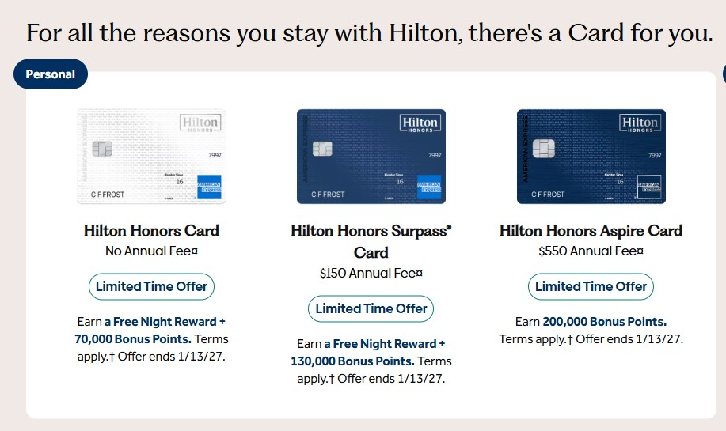
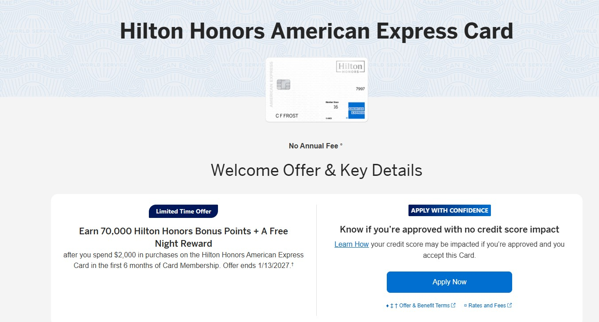
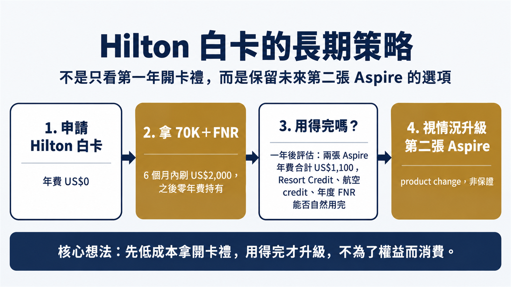
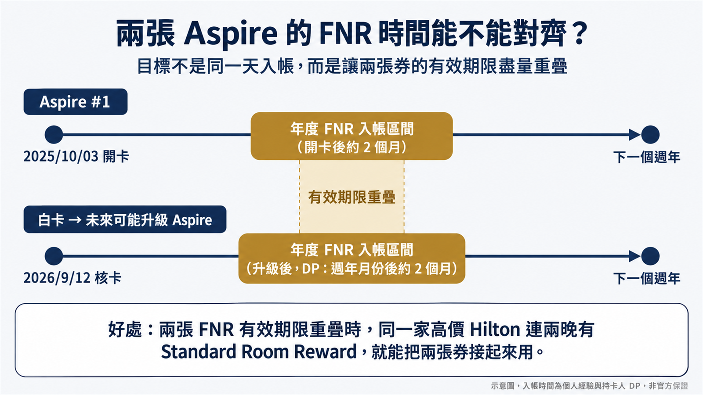

2026 年 9 月 12 日，我收到 Amex 的核卡信：Hilton Honors 白卡。

我手上已經有一張 Hilton Aspire，本來就是 Diamond 會籍。照理說，一張零年費、只送 Silver 會籍的白卡，對我幾乎沒有吸引力。

但這一波 Hilton 美國 Amex 三張個人卡一起換上限時開卡禮，活動頁面標示到 **2027/1/13**。點數最高的是 Aspire 的 200K，真正讓我動手申請的，卻是**年費 US$0 的白卡也送一張 Free Night Reward（FNR）**——而且它有機會成為我第二張 Aspire 的起點。

_圖片來源：Hilton／American Express 官網，截圖時間 2026/09/11。Offer 與條款可能變動，申請前請以實際申請頁面為準。_

---

## 三張 Hilton 個人卡，這次的 Offer 差在哪裡？

| 卡片 | 年費 | 限時開卡禮 | 消費門檻 |
|---|---:|---|---:|
| Hilton Honors Card（白卡） | **US$0** | **70K + 1 FNR** | 6 個月內 US$2,000 |
| Hilton Honors Surpass | **US$150** | **130K + 1 FNR** | 6 個月內 US$3,000 |
| Hilton Honors Aspire | **US$550** | **200K** | 6 個月內 US$6,000 |

三張卡不是單純比誰點數多。

白卡勝在零年費與低門檻：6 個月刷 US$2,000，平均每月約 US$333，多數人放進原本的日常消費就能完成。

Surpass 多付 US$150 年費，換到 130K 點數、Gold 會籍與每季 Hilton credit。Gold 最實用的是早餐：美國以外多數 Hilton 飯店可享免費早餐。對常去日本、韓國、東南亞的台灣旅客來說，這是很容易兌現的福利。

Aspire 年費 US$550，核心權益是每年 1 張 FNR、Diamond 會籍、**每半年最高 US$200 的 Resort Credit（全年最高 US$400）**，以及**每季最高 US$50 的航空消費 credit（全年最高 US$200）**。

它的價值取決於你原本有沒有 Hilton 住宿計畫、能不能自然用掉 Resort Credit、每年有沒有適合拿 FNR 去換的旅行。**為了消耗 credit 刻意增加住宿或機票支出，帳面回饋再漂亮也不一定划算。**

---

## 我怎麼選：白卡、Surpass、Aspire

- **想用最低持有成本進場：選白卡。** 70K 加一張 FNR 已經是完整的開卡價值，之後也保留升級的可能。
- **用得到 Gold 早餐、能固定用掉每季 Hilton credit：選 Surpass。** 要先確認 US$150 年費換到的權益不是紙上價值。
- **能明確用到高階飯店權益：選 Aspire。** 200K 是三張中最高的 offer，代價是 US$550 年費與 6 個月 US$6,000 的門檻。

_圖片來源：American Express 官網，截圖時間 2026/10/18。_

---

## Hilton FNR 能換到什麼？不是固定 35K、50K 或 85K

Hilton FNR 跟 Marriott 那種有點數上限的房券不同。

依 [Hilton Free Night Reward 官方條款](https://www.hilton.com/en/hilton-honors/free-night-reward-terms/)，關鍵是飯店當晚有沒有開放 **Standard Room Reward**。只要有標準獎勵房庫存，一張 FNR 就能換一晚，不管那晚標價多少點（仍須排除官方列出的不適用飯店）。

我自己的例子：今年夏天我用 Aspire 的 FNR 訂清境老英格蘭，訂到的是 Standard Room Reward，確認單上的房型是 Fantasia 山景套房——Standard Room Reward 不一定是最入門的房間。那晚的標價是 **105,000 點**，比這次白卡送的 70K 點數還多。完整過程寫在[住進清境的英式莊園：老英格蘭 Fantasia 套房實住](/posts/hilton-aspire-fnr-old-england-manor)。

反過來說，拿去住原本現金價不高的飯店，一張 FNR 的價值就普通。

兩個容易漏掉的細節：

- FNR 以標準房、雙人入住為基礎，帶小孩同行要先確認飯店的入住規定
- 入住日要落在 FNR 到期日之前，不是到期前訂好房就算

---

## 為什麼我已經有 Aspire，還申請白卡？

白卡不只是 Aspire 的低階版。它沒有年費，拿完開卡禮後可以低成本一直留著；之後如果 Aspire 的權益還符合需求，也保有 product change 升級成 Aspire 的可能。

這跟我當初申請 Chase Marriott Bonvoy Boundless 的思路很像：Boundless 不只是當下的開卡禮，也是未來可能 product change 成 Ritz-Carlton Card 的入口（完整申卡順序見我的[美卡申請歷程](/posts/us-credit-card-guide)）。

這不是鼓勵第一年就急著升級。一年後要不要升，得重新算兩張 Aspire 合計 US$1,100 的年費，自己能不能真的用掉。兩張卡的 Resort Credit、航空 credit 與兩張年度 FNR 都能自然用完，雙 Aspire 才有意義；如果得額外安排消費或住宿去追 credit，就本末倒置了。

---

## 兩張 Aspire 的 FNR 時間，可以對齊嗎？

我的第一張 Aspire 是 **2025/10/03** 開卡，白卡則在 **2026/9/12** 核卡，兩個帳戶的週年月份差不到一個月。

如果未來把白卡升級成 Aspire，兩個帳戶的週年月份就很接近。根據 FlyerTalk 與美卡論壇的部分回報，Hilton 卡升級後**原帳戶的會員年度通常不變**，不會以升級日重新起算。不過這屬於持卡人的 Data Point，不是 Amex 對每個帳戶的保證。

這裡也要把三種 FNR 分開看：

| FNR 類型 | 怎麼來 | 時間點 |
|---|---|---|
| 開卡禮 FNR | 白卡 6 個月內刷滿 US$2,000 | 達標後約 8～12 週 |
| 升級 FNR | 部分持卡人回報首次升級 Aspire 時額外拿到一張 | 非官方政策，不保證 |
| 年度 FNR：第一張 | Aspire 開卡後發放 | 我的經驗：2025/10/03 開卡，約 2 個月左右入帳，2026/7 用掉 |
| 年度 FNR：之後每年 | Aspire 每個持卡年度一張 | DP：多在週年月份後約 2 個月入帳，不會剛好落在週年日 |

所以我不會說兩張券能在同一天入帳。我真正想提高的，是**兩張年度 FNR 有效期限重疊的機會**——日後碰到同一家高價 Hilton 連續兩晚都有 Standard Room Reward，就能把兩張券接起來，不必處理一張快過期、另一張還沒發下來的尷尬。

這是我正在走的方向，不是已經完成的雙 Aspire 實測。目前白卡已經達標，70K 和開卡禮 FNR 都入帳了；手上持有 Aspire，並沒有影響這張白卡的開卡禮（這是我自己的 DP）。要不要升級，到時候用當時的條件再算一次。

---

## 申請前，兩件事不能忽略

**公開 Offer 不代表每個人都拿得到。** Amex 可能依你的持卡與開卡紀錄，在申請流程跳出 welcome-offer popup。看到不符合開卡禮資格的提示，就該停下來重新評估。另外，Amex 的開卡禮原則上一張卡一輩子只能拿一次。

**不要為了限時 Offer 硬湊消費。** 白卡 US$2,000、Surpass US$3,000、Aspire US$6,000，都應該放進原本的支出完成。

---

放進我目前的卡片組合，答案是白卡；換成你的組合，結論可能不一樣。

如果你也在評估這三張卡，或想討論沒有 SSN、用 ITIN 申請美國 Amex 的路徑，歡迎留言或透過[聯絡頁](/contact)私訊我。

下一篇我會把 **雙 Aspire 的 US$1,100 年費**拆開算：兩張年度 FNR、Resort Credit 與航空 credit，要怎麼用才不是為了權益而消費。

---

附註：本文依 2026 年 9 月公開 Offer、官方條款與近期 Data Point 整理，不構成保證核卡、保證取得 welcome offer 或保證升級的承諾。開卡禮、年費、福利、FNR 核發與 product change 規則，請以申請當下 Amex／Hilton 官方頁面及個人帳戶實際顯示為準。
