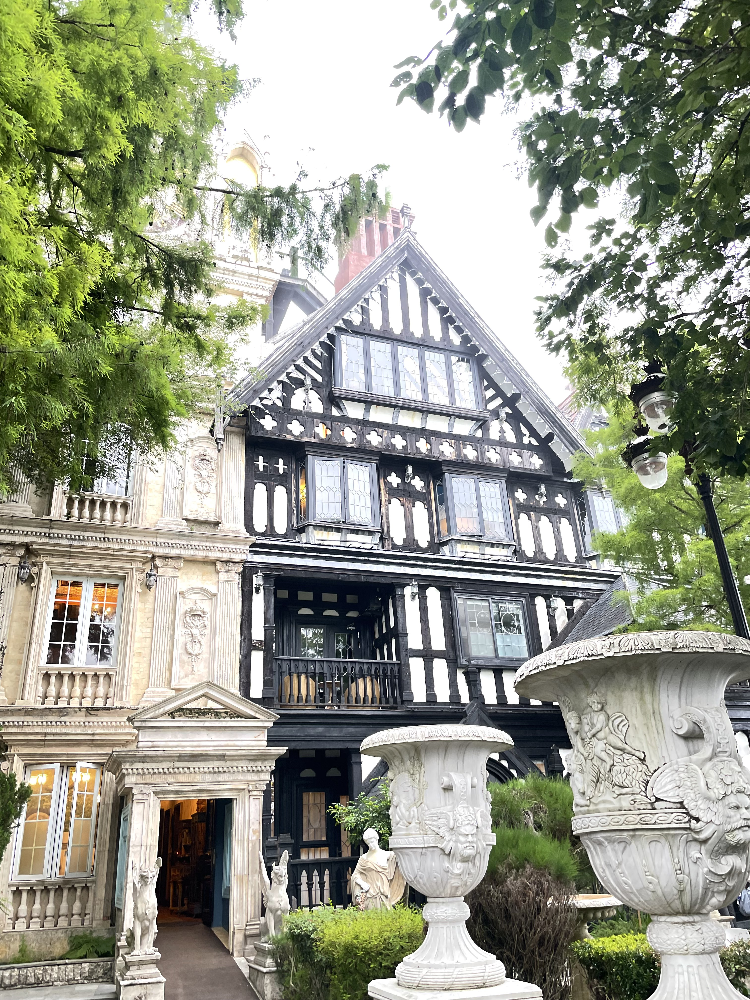
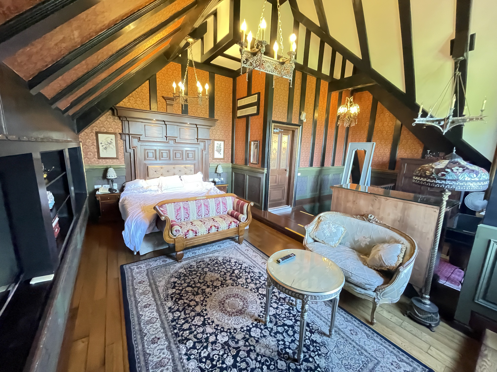
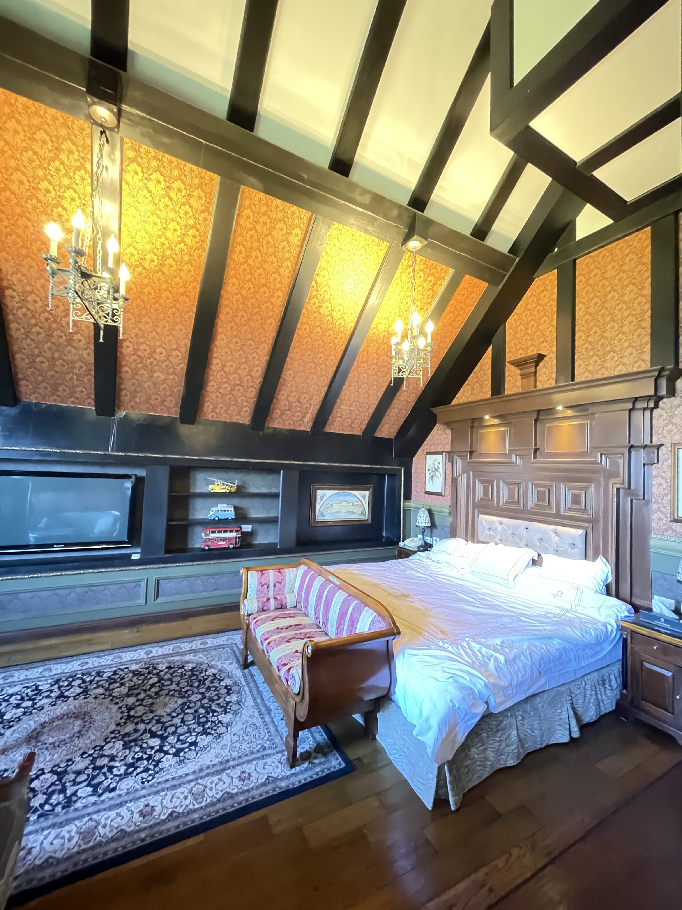
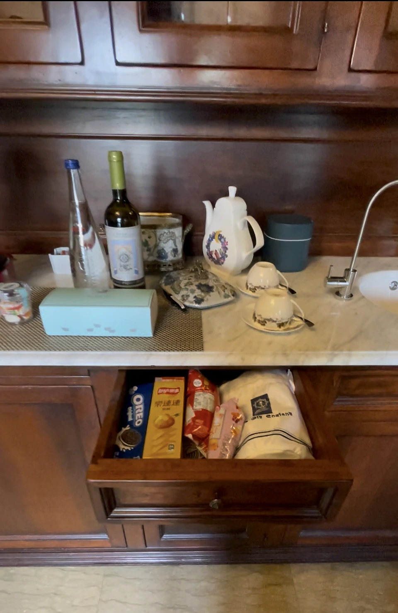
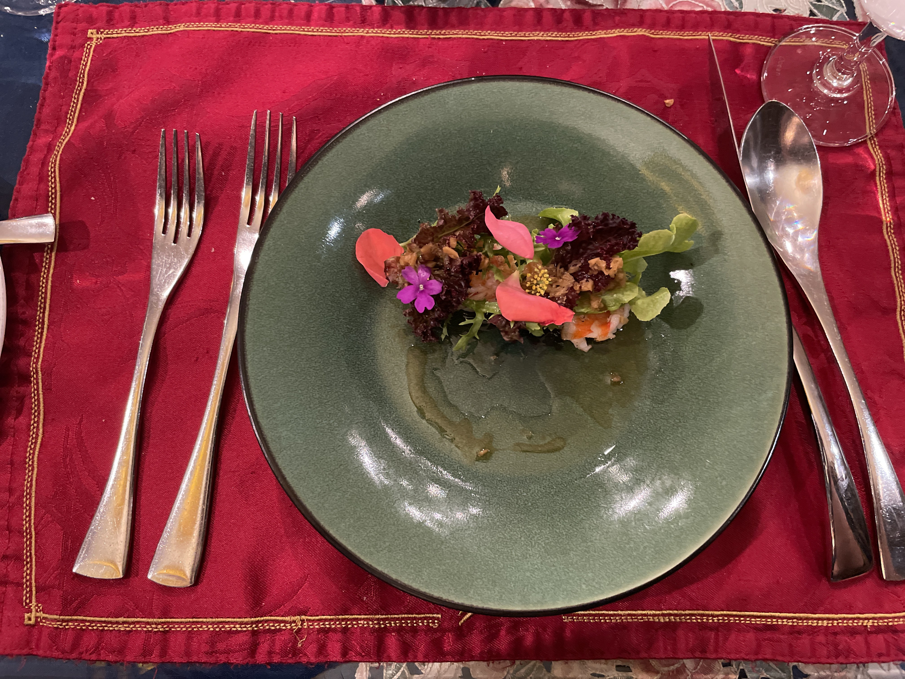
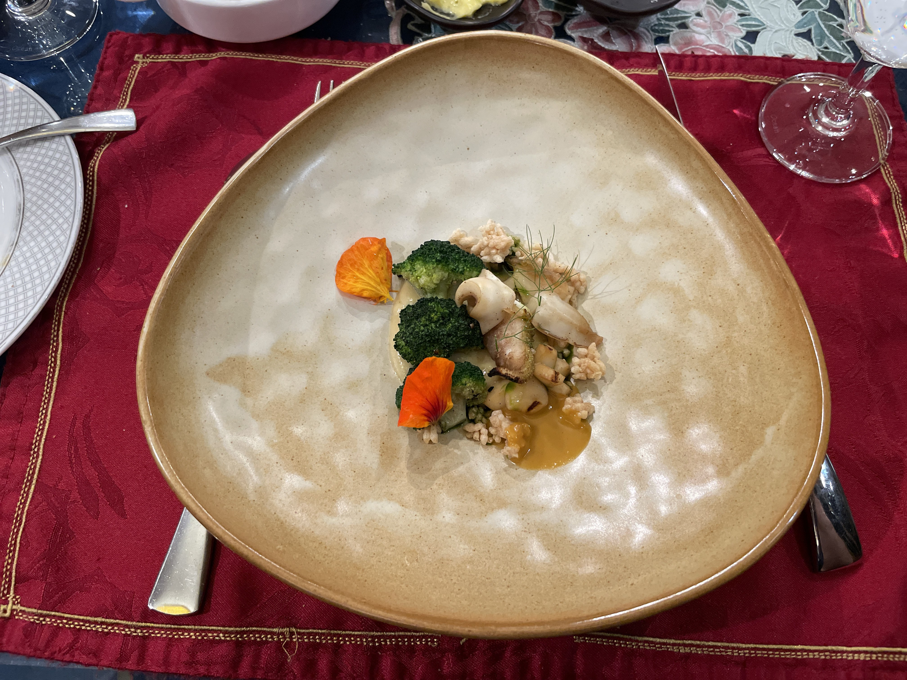
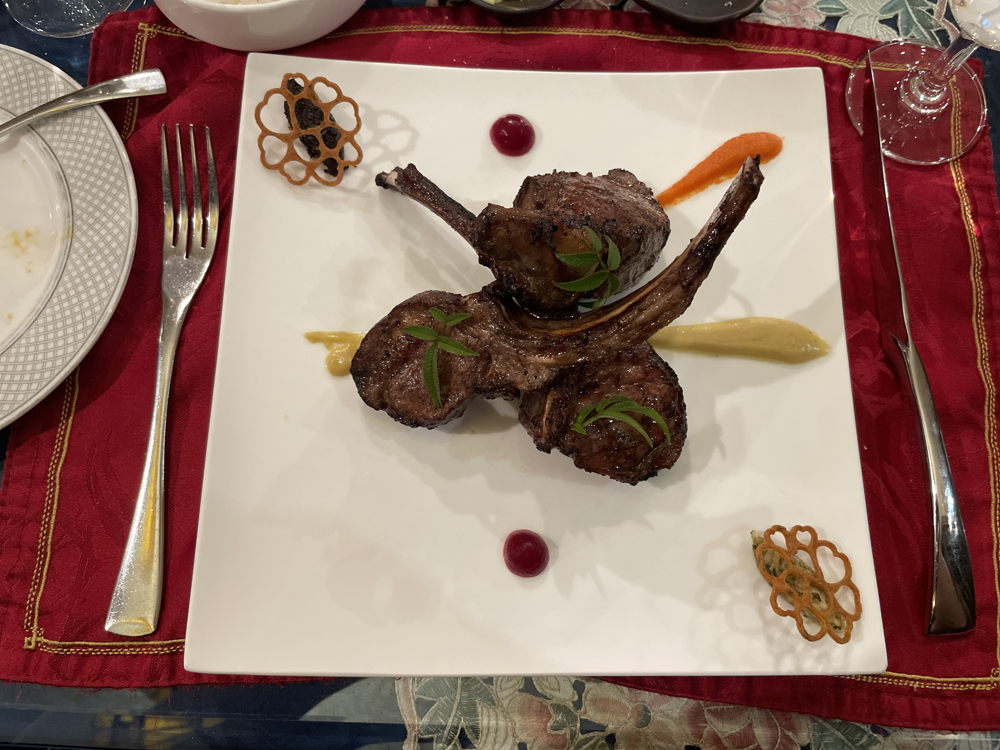
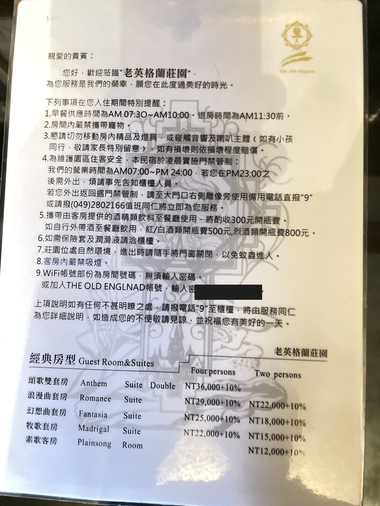

# 住進清境的英式莊園：老英格蘭 Fantasia 套房實住

抵達老英格蘭時，莊園的半木結構、尖塔與石雕都籠在霧裡。從外觀看，它像一座被搬到清境山上的英式古堡；走進房間後，這套風格也一路延伸到裡面。

我這次住的是 Fantasia 山景套房。原本最期待的是莊園外觀，住完之後，反而是房間的空間、細節和餐食更讓我留下印象。

---

## Fantasia 套房：不是只有「古典風」

進房間第一眼看到的是挑高的都鐸式木樑天花板，下面掛著兩盞鐵藝燭台吊燈。深色木作、橘金色壁紙、雕花床頭屏板與大面波斯地毯，把外面的莊園風格一路延伸進房間。

房間也不只是一張床加一組沙發。睡眠區與客廳區分成兩塊，中間還有一段高低差；客廳擺了一組法式沙發，床尾另外放著條紋長凳。裝飾雖然很多，但空間夠大，住起來並不會覺得擁擠。

電視旁的展示架擺著紅色老倫敦雙層巴士等模型車，浴室則用藍白地中海磁磚搭配大理石檯面。從天花板、家具到這些小擺設，看得出來都是一起搭配過的。

帶我們進房時，服務人員看到我的 Hilton Honors Diamond 會籍，提到 Diamond 會員在設有行政酒廊的 Hilton 飯店可以免費使用酒廊。不過老英格蘭是 SLH 成員，本身沒有行政酒廊，因此房內準備了不少餅乾、飲料和一瓶酒，讓我們免費享用。

我的 Diamond 會籍也是 Hilton Aspire 附帶的福利，不用先靠大量住宿慢慢累積。Hilton 在 2026 年新增了更高一級的 Diamond Reserve，因此 Diamond 已不是最高會籍，但在適用飯店仍包含行政酒廊等權益。對不常累積 Hilton 房晚的人來說，這是 Aspire 除了免房券以外，另一項實際用得到的福利。<a href="https://global.americanexpress.com/card-benefits/detail/complimentary-diamond-status/hilton-aspire" target="_blank" rel="noopener noreferrer">Amex 官方福利說明</a>

隔天早餐供應到早上 10 點。吃完還不用急著退房，可以再回房間休息一段時間。住在山上，早上能這樣慢慢來很舒服。

---

## 晚餐每人 1,600：值得留在莊園裡吃

這次房間是用 Hilton Aspire 每個持卡年度附贈、沒有另列點數上限的 FNR 免房券預訂。住宿本身不含晚餐，因此我另外加購了（**每人 NT$1,600**）。原本只是想把晚上的時間留在莊園裡，實際吃完卻比預期精緻。它不是一桌方便出餐的合菜，而是一道一道上的西式套餐。

前菜是綴著食用花的生菜沙拉，配堅果碎與海鮮絲。

主餐之一是煎透抽，底下不是白米燉飯，而是帶有顆粒口感的珍珠麥，旁邊搭配青花菜、茴香葉與金蓮花。

另一道是帶骨烤小羊排，佐莓果醬、胡蘿蔔泥與蕾絲脆餅。

擺盤、食器與上菜節奏都比我原本預期講究，服務人員也很親切、專業。以每人 1,600 元的價位來說，這頓我會願意再吃一次。傍晚留在莊園裡慢慢吃完，再直接回房休息，安排起來也很輕鬆。

---

## 晚餐之後，還有一場音樂欣賞會

晚餐結束後，莊園的行程還沒結束。晚上可以到莎士比亞音樂廳參加音樂欣賞會，服務人員介紹，現場使用的是一套千萬級的法國 Focal Grande Utopia 音響。曲目從古典樂到流行歌曲都有，不需要懂器材，坐在華麗的音樂廳裡，把一首歌完整聽完，本身就很有氣氛。

進場後，旁邊還有一個小吧台，可以免費點一杯酒或無酒精果汁。拿著飲料坐進沙發，一邊喝、一邊聽音樂，比單純介紹一套昂貴器材更有意思，也更像是莊園替住客安排的一段夜間時光。

這也是我很推薦留下來參加的活動：白天看莊園、傍晚吃晚餐，晚上再用一段音樂收尾，整天的住宿體驗也因此更完整。<a href="https://theoldengland.com/experiences" target="_blank" rel="noopener noreferrer">老英格蘭官方莊園體驗介紹</a>

---

## 這一晚，我是用 Hilton Aspire 免房券訂到的

這次我不是用現金訂房，而是用了 Amex Hilton Aspire 每個持卡年度附贈的一張 Free Night Reward（FNR）。

老英格蘭不是 Hilton 自有品牌，而是 **SLH（Small Luxury Hotels of the World）** 的成員。SLH 與 Hilton Honors 合作後，部分房型也能透過 Hilton 的獎勵住宿系統預訂。

我入住當晚的 Standard Room Reward 要 **105,000 點**，但 FNR 不是拿來折抵點數。依 [Hilton 現行條款](https://www.hilton.com/en/hilton-honors/free-night-reward-terms/)，只要當晚有符合資格的 standard accommodation 庫存，一張券就能換一晚。

我不是因為手上有券才挑老英格蘭，而是本來就想住，剛好發現可以用 FNR。這樣用券對我來說比較實在，不用為了「把券用掉」特地安排一間原本沒打算住的飯店。

---

## FNR 怎麼兌換

FNR 不能在網站上自行套用。Hilton 官方條款列出的兌換方式是電話；我這次則透過 Hilton 客服 chat 處理。

聯絡客服後，提供飯店名稱與入住日期，再請客服確認當晚是否有 Standard Room Reward。FNR 只能兌換這類獎勵房，並不是每個日期、每種房型都能使用；如果日期有彈性，可以請客服一起查看前後幾天。完成預訂前，也要確認房型、入住人數與取消政策。

---

## 訂的是 Standard Room Reward，住進去卻是套房

原本以為 FNR 兌換的 Standard Room Reward，只會是飯店最基礎的房型。沒想到訂房確認上寫的是 Fantasia 山景套房，當下就覺得很驚喜，實際住進去後更是超出預期。

老英格蘭官網目前列出 9 種房型。我這次換到的 [Fantasia 幻想曲套房](https://theoldengland.com/rooms/fantasia-suite-king) 約 46～66 平方公尺，雖然上面還有更高階的房型，但獨立的睡眠區與客廳區，已經很有住套房的感覺。

這次也讓我發現，Hilton 系統裡的「Standard Room Reward」，不一定就是飯店最入門的房間。

---

## 退房前看到房價牌，才回頭算這一晚

退房前，我在房裡拍了一張房價表。Fantasia Suite 雙人牌價是 NT$18,000 加一成服務費，也就是 **NT$19,800 起**。

_房內的房價表，WiFi 密碼已遮。_

| 房型 | 雙人 | 四人 |
|------|------|------|
| 幻想曲套房 Fantasia Suite | NT$18,000 +10% = **19,800** | NT$25,000 +10% = 27,500 |

免房券只是讓這趟住宿比較容易成行。實際住過一晚，才發現老英格蘭從外觀、房間到餐食，都維持著同一種莊園氛圍。

從抵達時霧裡的半木結構建築、進房後挑高的木樑與分成兩區的空間，到傍晚留在莊園裡慢慢吃完一套餐，整晚的感受是連在一起的。隔天吃完早餐，還能回房間休息到退房。這些細節加起來，才是我會想再回來的理由。

---

## 想用 FNR 訂老英格蘭，這幾點要注意

- **先找 Standard Room Reward：** 我入住當晚可以用 105,000 Hilton 點兌換，而我是用一張 FNR 完成預訂。
- **日期最好保留彈性：** 只有單一日期能入住，兌換難度自然比較高。
- **晚餐與交通仍是額外成本：** 我這次晚餐每人 NT$1,600，FNR 免掉的是房費，不是整趟旅程的所有支出。
- **逐筆確認取消政策：** 我這張訂單在入住前 14 天後，取消費用會依日期從 30% 提高到 100%；FNR 是否退回，也要以訂房確認信和 Hilton 客服答覆為準。

---

附註：這是我這一次的入住與兌換 DP，不是通則。Aspire 福利、FNR 條款、SLH 與 Hilton 的合作關係、房型需求與現金牌價都可能變動，預訂前請以 Amex、Hilton 與飯店當期公告為準。

這次使用的 FNR，跟 Aspire 每年提供的度假村 credit 是兩項不同福利；老英格蘭也不在該 credit 的適用清單裡。下一篇我會再把 Aspire 的年費、FNR、度假村 credit、航空 credit 與鑽石會籍分開來算，看看哪些福利在台灣真的用得到。

隔天吃完早餐，再回到那間像莊園客廳一樣的房裡，慢慢待到退房，是我這趟最喜歡的一段。
