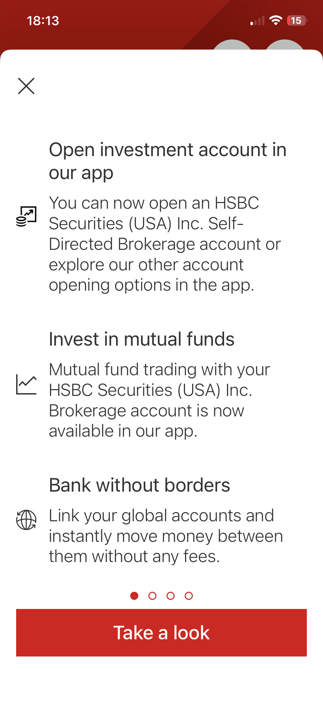
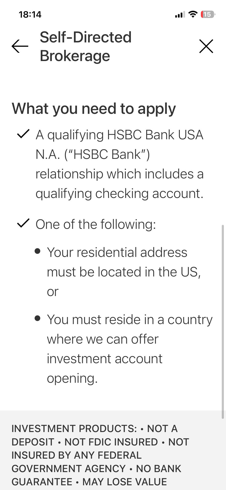
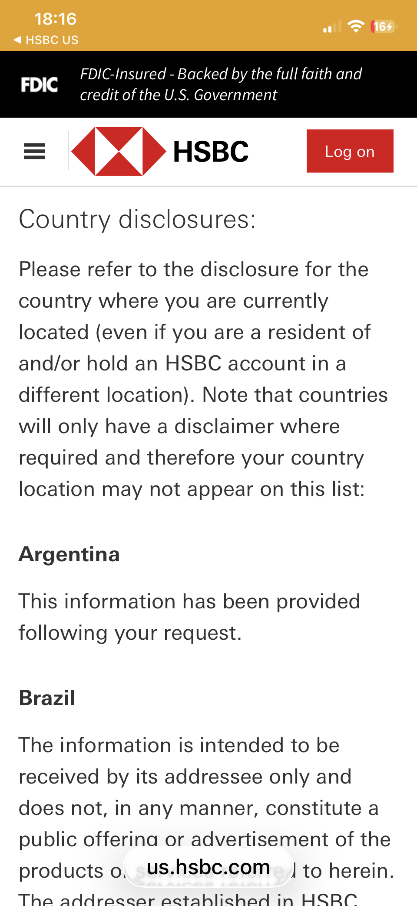
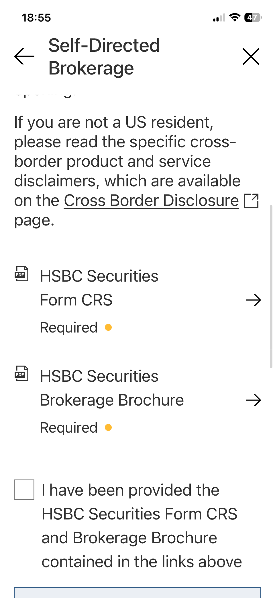
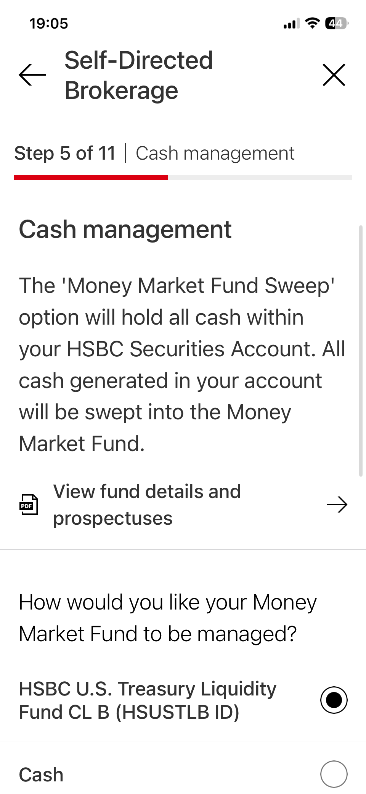
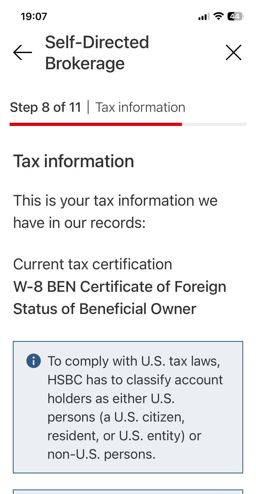
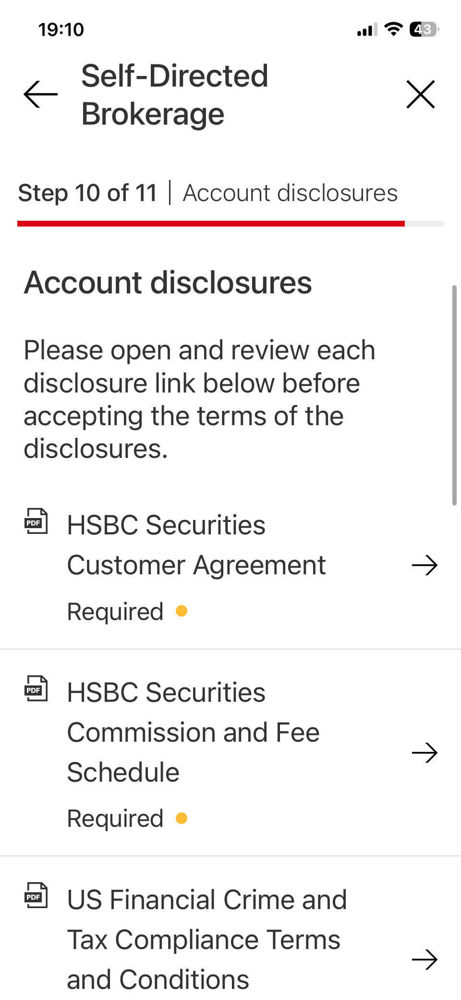
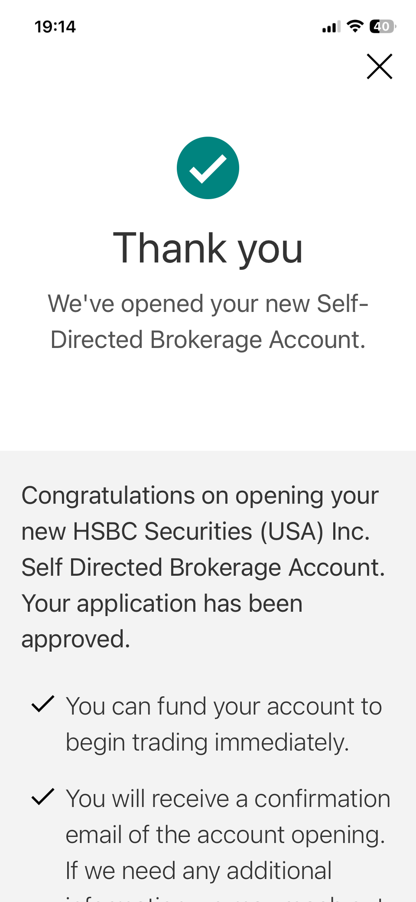

2025 年，我打電話問過 HSBC 美國的客服：我想開一個自己下單的美股券商戶。

客服的回答很明確：以我的資格，只能申請**有經紀人的投資帳戶**，沒辦法開自己買股票的 Self-Directed 帳戶。

因為這件事，我等了大半年。

2026 年 7 月 25 日，週六，我在社群上看到一則貼文：「HSBC US 可以自助開 Brokerage account 了」。我打開 HSBC US App 確認，App 裡真的跳出新功能介紹：「You can now open an HSBC Securities (USA) Inc. Self-Directed Brokerage account」。

點進去走完 11 個步驟，**不到半小時就核准了**。這篇把每一步是什麼頁記下來，也把開戶前容易看錯的幾份文件講清楚。

_圖片來源：HSBC US App 實截。_

**這不是一篇「人人都能開」的教學。** 它有一個很硬的前提：你得先有 HSBC 美國的 Premier 關係。卡不卡得過，看下面兩個前提就能判斷。

---

## Self-Directed Brokerage 是什麼，以前為什麼開不了

HSBC Securities (USA) 的 Self-Directed Brokerage，就是一個**你自己下單、沒有理專插手**的美股券商戶，清算商是 Pershing（交易平台 NetXInvestor）。

**今年 3 月 HSBC 官網的存檔（archive.org，2026-03-01）還寫著，申請人必須是美國全職合法居民，而且不是任何其他國家的居民。** 對住台灣的人來說，這句話就是句點。

到了 7/25 我開戶那天，App 裡的資格頁已經換了寫法；現在官網的申請資格也改成了跨境版本（查證日 2026-10-23）。**7/25 那天 App 已經有跨境申請的路，我人在台灣申請成功。**

---

## 誰能開：兩個前提

**前提一：你要先有 HSBC 美國的合格關係，含一個合格支票戶。**

這是最硬的一關。台灣人拿到 HSBC US 帳戶的常見路線，是先有 **HSBC 台灣的卓越理財（Premier）**，再走跨境關係在美國端開 US Premier。台灣 Premier 的門檻是**每月平均往來餘額新台幣 300 萬**。

坦白說，這一關比開券商戶本身難多了。**我自己是 HSBC 台灣、新加坡、香港、美國四地都有 Premier，所以美國這關早就過了。** 如果你連 HSBC US 帳戶都還沒有，要先解決的是怎麼開 HSBC US Premier，這條路我寫在[沒有 ITIN/SSN、沒有美國地址，我怎麼申到美國信用卡](/posts/hsbc-us-elite-application-from-taiwan)。

**前提二：你的居住國要在「HSBC 可以提供投資開戶」的範圍內。**

最直接的確認方法是進 App 走走看。**台灣居民可以通過 Step 8 稅務這一步，我最後也核准了。**

稅務身分方面，我當時 HSBC US 的檔案裡已經留存 W-8BEN，Step 8 稅務頁直接顯示這份，不用重填。

---

## 11 步實測：每一步是什麼頁

**入口**：App 跳出的新功能介紹 →「Take a look」，進到 Self-Directed Brokerage 的說明頁。

**資格頁（What you need to apply）**：列出兩個條件。一是合格的 HSBC Bank USA 關係＋支票戶；二是居住地二選一：「住址在美國」**或**「你居住在我們能提供投資開戶的國家」。後面這句，就是國際客戶的入口。

_圖片來源：HSBC US App 實截。這一頁是整件事的關鍵。_

**提醒：跨境揭露清單沒有台灣，不代表不能開。** 開始填表前的揭露頁上寫著：如果你不是美國居民，請先讀官網的 Cross Border Disclosure（跨境揭露）頁，裡面有一份國家揭露清單。台灣不在這份清單上，但那頁自己寫明：只有需要特別免責聲明的國家才會列出，**你的所在地可能不在清單上**。這是免責揭露，**不是開戶資格清單**。

_圖片來源：HSBC US 官網 Cross Border Disclosure 頁實截。_

**揭露勾選**：開始填表前，要先點開兩份標了「Required」的 PDF：Form CRS 和 Brokerage Brochure，才勾得了「我已收到這些文件」。

**提醒：Form CRS 不是稅務的 CRS。** 這裡的 CRS 是 **Customer Relationship Summary（客戶關係摘要）**，美國證管會要求適用的券商與投資顧問提供給零售客戶，內容是服務項目、收費方式和利益衝突。它跟稅務上的 Common Reporting Standard（共同申報準則）是兩回事。

_圖片來源：HSBC US App 實截。_

**Step 1 — 個人與聯絡資料**：姓名、國籍、是否為美國居民、出生日期等基本資料。

**Step 2 — 職業資料**：就業狀態、職業、行業別、雇主名稱。

**Step 3 — 財務資訊**：年收入、淨資產（不含自住房）的級距，用下拉選單選。

**Step 4 — 利益關係**：本人或直系家屬是否任職券商、交易所或證券監理機關；是否有其他券商戶；是否為上市公司董事、高階主管或持股 10% 以上的股東。

**Step 5 — 現金管理**：選閒置現金怎麼放。選項是掃進 **HSBC U.S. Treasury Liquidity Fund**（美國公債貨幣基金），或留在 Cash。旁邊有基金說明書可以先看。我當時選的是 HSBC U.S. Treasury Liquidity Fund（下圖是當時勾選的畫面）。

_圖片來源：HSBC US App 實截。_

**Step 6 — 處分方式＋投資目標**：系統預設賣股時用 FIFO（先進先出）計算成本，問你要不要改；同一頁還要從下拉選單選投資目標。這兩格沒有標準答案，照自己的投資方式選就好。

**Step 7 — 資金來源**：反洗錢例行題，問這個戶頭第一筆錢從哪來。選項有累積存款（Accumulated Savings）、工作收入、繼承、贈與等，照實選。

**Step 8 — 稅務資訊**：畫面顯示 HSBC 檔案裡你目前的稅務認證（W-8BEN）和稅籍。確認無誤，勾「我已讀過稅務資料並確認正確」就能往下。

_圖片來源：HSBC US App 實截。_

**Step 9 — 信任聯絡人**：信任聯絡人（Trusted Contact）可選填；券商聯絡不到你、或合理懷疑帳戶遭財務剝削時，可聯絡此人。這項指定不授予代你交易的權限。

**Step 10 — 帳戶揭露文件**：一共 7 份標了 Required 的 PDF：客戶協議、手續費表、美國金融犯罪與稅務合規條款、外語客戶聲明、現金掃入選項說明、Key Information Document、隱私權聲明。每份都要點開過，才能勾「全部接受」。

_圖片來源：HSBC US App 實截。_

**Step 11 — 電子簽名**：勾一句「我提供的所有資料屬實，包含我的稅務身分」，畫面會帶出你的名字和當天日期，效力等同親筆簽名。

**完成**：送出後畫面直接顯示「Your application has been approved.」。

**同一頁也提醒：如果需要更多資料，HSBC 可能在 48–72 小時內聯絡你補件。**

隨後就收到核准信，信上說新帳戶會出現在 HSBC US 網銀裡，Welcome Kit 約 7–10 個工作天寄出。

_圖片來源：HSBC US App 實截。_

---

## 手續費：每筆 $10.99 固定

開好之後，最實際的問題是買賣要多少錢。以下是官方費率表（2026 年 7 月 15 日生效版）的重點：

| 項目 | 費用 |
|------|------|
| 美股／美國 ETF（線上） | **$10.99／筆**（固定，不看金額） |
| 美股（透過 Wealth Services Desk 電話下單） | $35／筆 |
| 國際股票（例如倫敦掛牌） | **本金 0.25%，最低 $65**，**只能電話下單**，另有匯兌等費用 |

自助戶目前不能交易選擇權（官方 FAQ）。

因為我是 HSBC Premier，閒置費、海外保管費、紙本帳單費、IRA 年費都免收。**但交易佣金不會因為你是 Premier 就免。**

$10.99 是固定價，同樣的佣金，換算成比例是：

- 買 $50,000 → 手續費占 0.02%
- 買 $500 → 手續費占 2.2%

換個方向算：

- 單筆約 **US$7,300**：佣金約 0.15%
- 單筆約 **US$9,200**：佣金約 0.12%

---

## 稅：台灣人先知道這幾條

我不是稅務顧問，以下不是稅務建議，數字請依你自己的情況與當期法規確認。對台灣人（美國稅法上的非居民外國人，NRA）來說，這幾條幾乎一定會遇到：

**美股股息，目前一般預扣 30%。** 台灣跟美國目前沒有租稅協定，一般美國來源股息就是預扣 30%，W-8BEN 本身不會讓它變低。國會有台美避免雙重課稅的法案，眾議院已通過、參議院審議中（查證日 2026-10-23）。

**證券的資本利得，美國通常不課。** 一般情況下（當年在美國未滿 183 天、沒有其他例外），NRA 買賣美股的價差，美國端通常不課稅。

**美國遺產稅，這條最多人不知道。** NRA 持有的美國境內資產（例如美股、美國註冊的 ETF）超過 **US$60,000**，身故時就有美國遺產稅的申報與課稅問題，稅率累進、最高 40%，繼承人通常還需要向 IRS 申請放行證明（transfer certificate）才能把資產領出來。**這條在任何美國券商都一樣，不是 HSBC 才有。**

**W-8BEN 的效期**：一般是從簽署日起，到簽署年後第三個曆年的年底為止；身分有變動的話可能提早失效。

---

## 開了，我要不要從 IBKR 搬家？我的打算：不搬

我原本在盈透（IBKR）買美股。開了 HSBC 這個戶，我打算這樣分工：

**核心的大盤 ETF，我打算留在 IBKR，用愛爾蘭註冊的 UCITS ETF。** 原因是稅務體質：愛爾蘭註冊的公司型基金，基金層級收美股股息通常預扣 15%（不是 30%），而且基金股份通常不算美國境內資產。實際結果還是要看個別基金的架構。另一個原因是成本：HSBC 這邊的國際股票要 0.25%、最低 $65，還只能電話下單。

**HSBC 這個戶，我打算拿來放大額、長抱的美股／美國 ETF。** $10.99 固定價在大額之下占比很低。

**錢的串接**：券商戶的錢可以跟 HSBC US 的支票或儲蓄戶互轉，再由存款戶用 Global Transfer 轉到其他地區的 HSBC 帳戶；券商戶本身不能直接做 Global Transfer。

**短頻、小額的交易，還是留在 IBKR。** $10.99 固定價對小額太重。

目前的實際進度：**我匯了 500 美金進券商戶，還沒買任何標的，倫敦的 UCITS 也還沒試。** 核准信裡有一行小字提醒：**某些商品會因為跨境限制與所用平台，被限制交易。** 所以 HSBC 這個平台到底讓不讓台灣人買 UCITS，我還不知道。

---

## 免責

我不是理專也不是稅務顧問，這篇是個人實測經驗分享，不構成投資或稅務建議。資格、費率、跨境產品限制都會變動，一切以 HSBC 官方當期公告為準。文中的金額與稅務數字，請依你自己的情況與最新法規確認。

---

## 下一篇

下一篇想確認：HSBC 能不能買倫敦掛牌的 UCITS ETF，以及實際交易成本。這部分還沒試，等實測後再分享。

如果你也在走「台灣人的美國金融系統」這條路，前面幾塊地基可以先補：[怎麼從退稅申請 ITIN](/posts/itin-application-from-taiwan)、[怎麼從台灣不用 SSN 申請到 HSBC US Elite 信用卡](/posts/hsbc-us-elite-application-from-taiwan)。有問題歡迎留言，我盡量回。

---

## 官方資料

- [HSBC 投資手續費表（PDF）](https://www.us.hsbc.com/content/dam/hsbc/us/en_us/investments/disclosures/hsbc-fee-schedule-investments.pdf)
- [HSBC Self-Directed Brokerage FAQ](https://www.us.hsbc.com/investments/products/self-directed-brokerage/faq/)
- [HSBC Cross Border Disclosures](https://www.us.hsbc.com/cross-border-disclosures/)
- [IRS：非居民外國人的美國來源所得預扣（含股息、資本利得）](https://www.irs.gov/individuals/international-taxpayers/federal-income-tax-withholding-and-reporting-on-other-kinds-of-us-source-income-paid-to-nonresident-aliens)
- [IRS：非居民遺產的 transfer certificate](https://www.irs.gov/businesses/small-businesses-self-employed/transfer-certificate-filing-requirements-for-the-estates-of-nonresidents-not-citizens-of-the-united-states)
- [Investor.gov：Trusted Contact](https://www.investor.gov/introduction-investing/general-resources/news-alerts/alerts-bulletins/investor-bulletins-trusted-contact)
