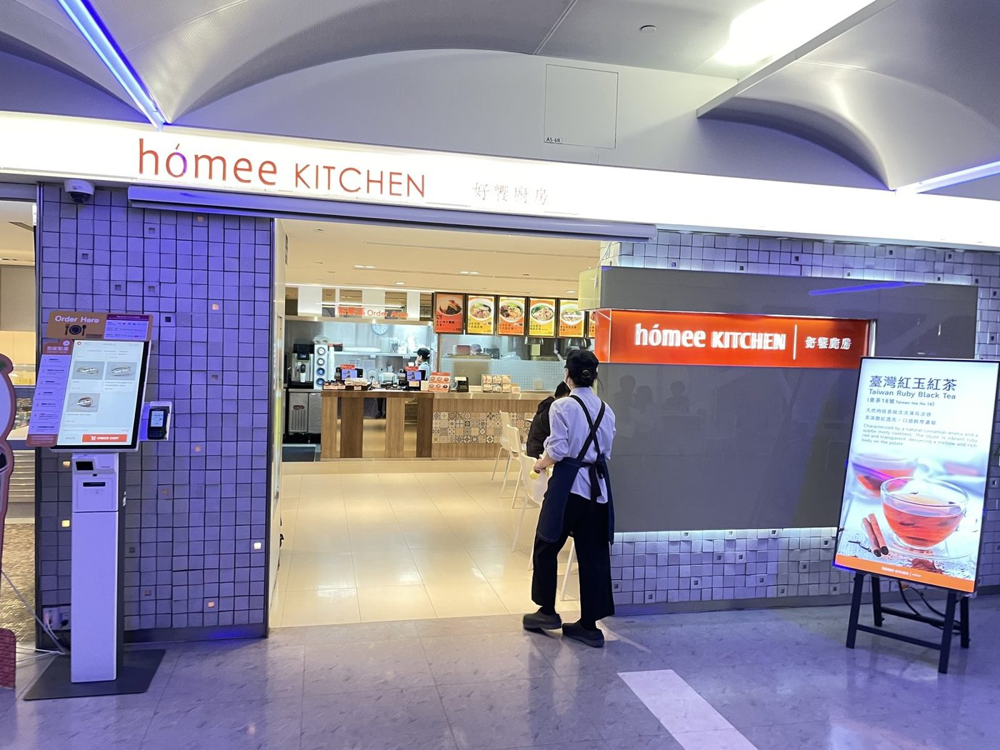
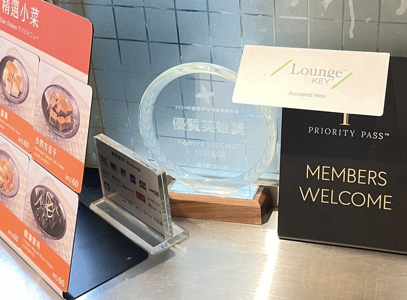
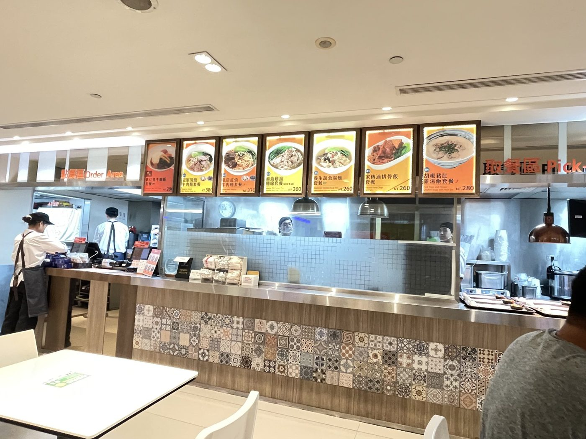
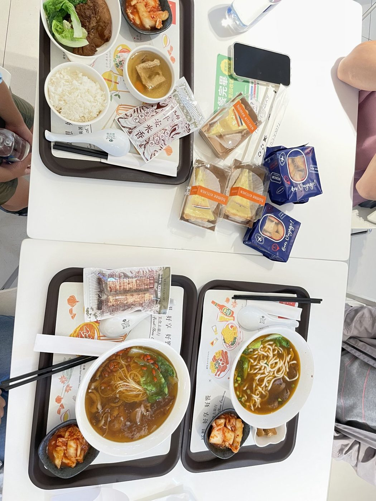
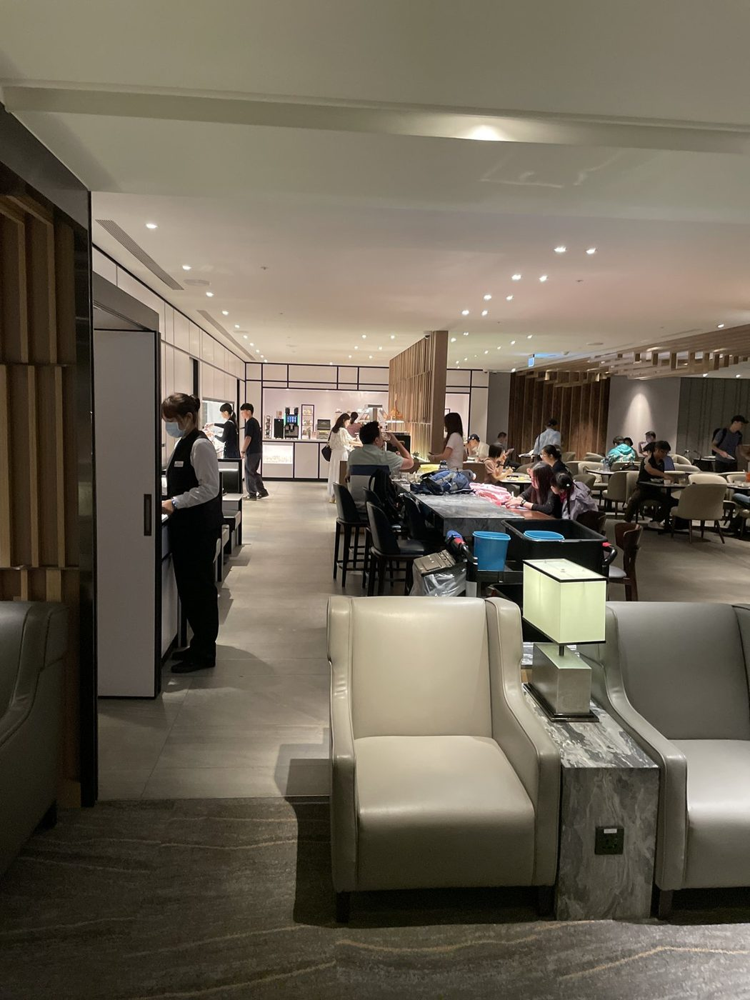

7 月 30 日要從桃園機場第一航廈出發，同行的有 2 個人。

我手上能用的是 HSBC US Elite 附贈的 Priority Pass，裝在手機的 PPS+ app 裡。這次沒有直接進貴賓室，而是先去了 **Homee Kitchen**——第一航廈管制區 3 樓 B 區、靠近 B5 登機門，一間可以用 Priority Pass 換餐的機場餐廳。

那天**只刷我一張卡，3 個人各拿到一份套餐**，沒補差額，也不用等。

## 這次怎麼點的

到了櫃台，選單上就是各式套餐，直接點。

我們點了三份，價格照櫃台上方燈箱的標價：

- **私房紅燒牛肉麵套餐**：NT$370
- **麻油雞湯麵線套餐**：NT$260
- **家傳滷排骨飯套餐**：NT$260

加起來是 **NT$890**。

每份套餐除了主餐，還附了 Bon Voyage 餅乾、homee 的塔、一瓶 FIJI 礦泉水，另外還有一包平安米香。

出示的是 PPS+ app 裡的電子會員卡，**全程只用我本人這一張**。2 位同行是以我的 guest 身分各點一份。

我在 [HSBC US Elite 實測](/posts/hsbc-us-elite-card-review) 提過 Priority Pass 有合作餐廳，這次在 Homee Kitchen 實測可用。

## 規則：哪些是官方寫的，哪些只是我那天的經驗

這段我分兩欄寫，因為機場餐廳的規則常改，我那天遇到的不一定等於現在的規定。

| 項目 | 官方條款（2026-10-23 查證） | 我的實測（2026/7/30） |
|---|---|---|
| 每人可換幾份 | 24 小時內 1 客套餐；套餐外的單點、飲品另外收費。**官方頁沒寫金額上限或補差額** | 每人一份套餐，沒補差額 |
| guest 能不能換、要不要錢 | guest 也是 1 客套餐，帳上記「1 次持卡者到訪＋1 次同行賓客到訪」；收不收費看你的方案 | 2 位同行各一份；PP 有消費紀錄，**HSBC 帳單沒有出現費用** |
| 同一趟還能不能進貴賓室 | 一份套餐＝**用掉 1 次貴賓室到訪**；官方英文頁寫同一趟重複使用「may result in charges from your benefit provider」 | 吃完又進了 Plaza Premium Lounge，HSBC 帳單沒有出現費用 |

guest 能不能免費，關鍵在**發卡銀行給的 Priority Pass 方案**，不是 Priority Pass 本身。HSBC US Elite 的部分，我在 [HSBC US Elite 實測](/posts/hsbc-us-elite-card-review) 那篇整理過條款：主卡或副卡持卡人加最多 2 位 guest，**每次機場到訪最多 3 人**。

副卡能不能各自用，請看 [副卡進貴賓室實測](/posts/hsbc-elite-authorized-user-lounge-tpe)，這篇不重複。

## 吃完之後

吃完我們再去 **Plaza Premium Lounge**，休息、喝飲料，大概 30 分鐘。

所以那天的順序是**先吃正餐、再進貴賓室**。官方把這種用法列為「可能被發卡機構收費」，我那次 HSBC 沒有收，但這只是一次經驗，不代表一定不收。

## 如果你也想這樣用

- 這篇的規則以 **Priority Pass 官方頁**為準，出發前自己再點開看一次：[Homee Kitchen（TPE10D）](https://www.prioritypass.com/zh-Hant-TW/lounges/taiwan-region/taiwan-taoyuan-international/tpe10d-homee-kitchen)
- guest 收不收費，看你的**發卡銀行**，不是看餐廳
- 點餐前要出示**會員卡＋當天的登機證**
- 我那天沒補差額、不用等、HSBC 帳單也沒出現費用，是 **7/30 當天的狀況**，不保證每張卡、每次都一樣

下一篇寫 **Capital One Venture X 的核卡過程**。
